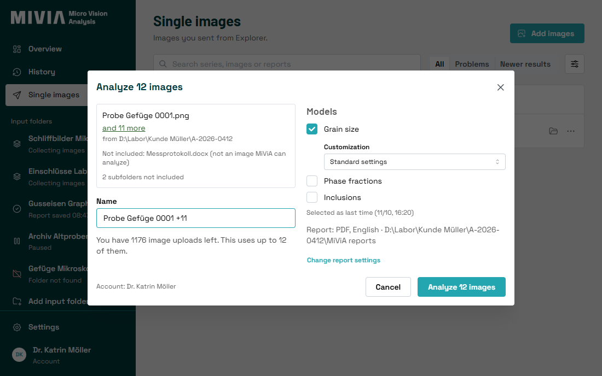
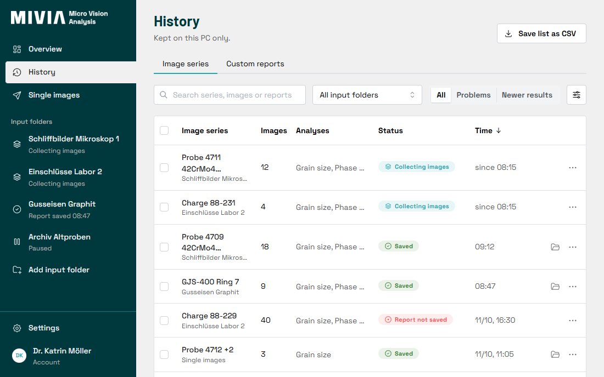

# MiViA Desktop

MiViA Desktop connects a lab PC to [MiViA](https://mivia.ai), the image analysis service for materials microscopy. Point it at the folder your microscope saves to: new images are grouped into image series, analysed on app.mivia.ai, and the finished PDF report lands next to them.


## What it does

- **Watches input folders.** Each folder has its own models and report settings. Images that arrive close together form one image series, and each series gets one report.
- **Analyses single images from Explorer.** Select images, right-click, *Send to > Analyze with MiViA*.
- **Keeps a local history** of every series and report, searchable and exportable as CSV. You can build a custom report from earlier results without uploading anything again.
- **Runs quietly in the tray.** It starts with Windows and waits out network drops and server maintenance without losing work. It updates itself.
- Comes in English and German.

Your images are never moved, renamed or deleted. They are uploaded only to the MiViA server your account belongs to. Usage statistics are off unless you turn them on.



## Getting started

1. Download the latest installer from [Releases](https://github.com/MiViA-GmbH/MiViA-Desktop/releases). It installs for the current user and needs no administrator rights.
2. Create an access key in the MiViA web app under [Access keys](https://app.mivia.ai/access-keys).
3. Start MiViA Desktop. Setup takes five steps: paste the key, choose the folder your microscope saves to, say how images form a series, pick the models, finish.


Requirements: Windows 10 or 11 (64-bit), a MiViA account with an active license, and HTTPS access to `app.mivia.ai` and `updates.mivia.ai`. If WebView2 is missing, the installer adds it.

## For IT

- Silent install for the signed-in user: `"MiViA Desktop_<version>_x64-setup.exe" /S`.
- Machine policies under `Software\Policies\MiViA\Desktop` can set the server, proxy, update mode, upload limits, telemetry, autostart and Explorer integration.
- The proxy comes from the Windows settings, including PAC and WPAD, unless a policy sets one. Proxy authentication is not supported.
- Updates come from this repository's releases. Each update is signed, and the app refuses any update whose signature or version does not match. See [SECURITY.md](SECURITY.md) for how to check an installer yourself.

## History



## Building from source

Toolchains are pinned in `.prototools` and installed with [proto](https://moonrepo.dev/proto): Rust, Node and pnpm.

```sh
proto use
pnpm install
pnpm --dir ui dev        # UI dev server
pnpm tauri dev           # the app, in a second terminal
pnpm check               # the same checks CI runs on a pull request
```

The Rust core is in `crates/`, organised as a domain core, ports and adapters. The Tauri shell is in `src-tauri/` and the React UI in `ui/`. Design decisions are recorded in [docs/adr](docs/adr), and the domain language is in [CONTEXT.md](CONTEXT.md).

## Reporting problems

In the app, *Settings > Support > Report a problem* sends the diagnostic log to MiViA support. You see exactly what will be sent first. For security issues, see [SECURITY.md](SECURITY.md).
