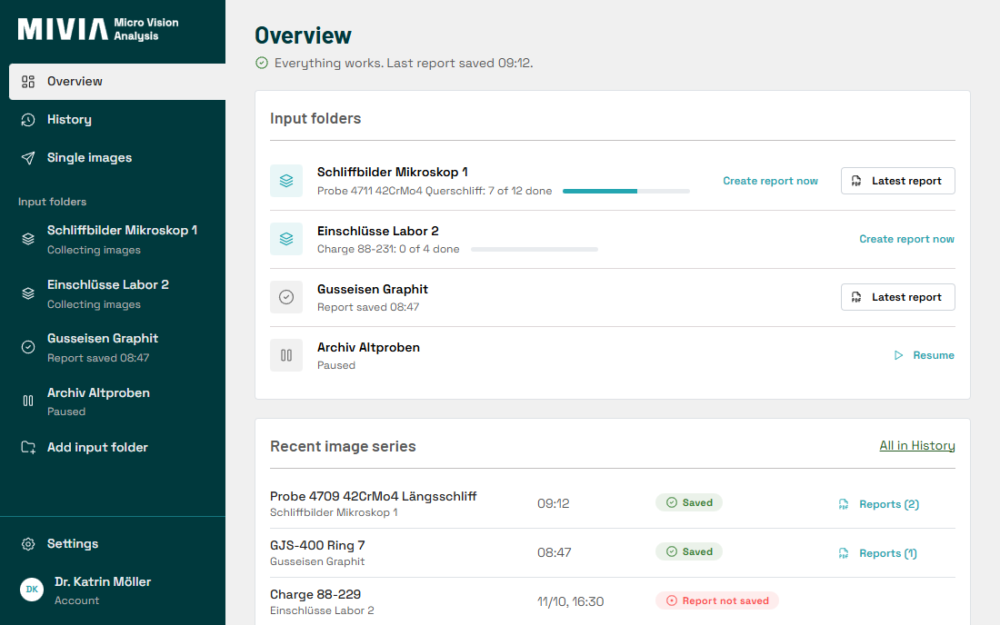
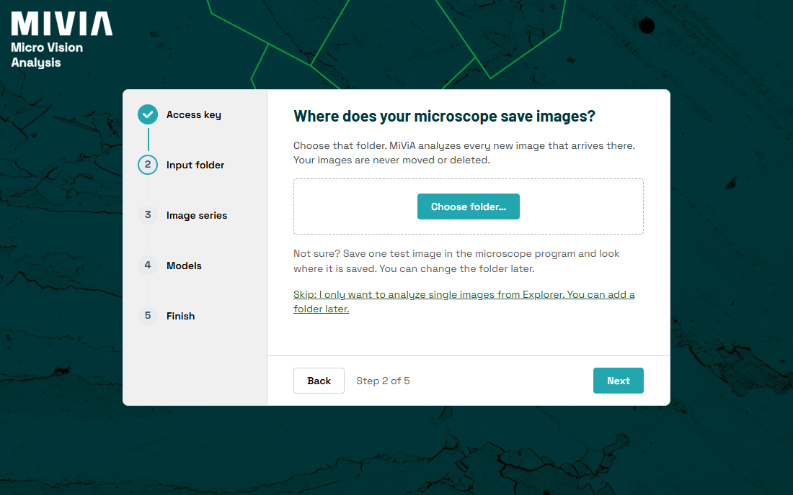

# MiViA Desktop

MiViA Desktop is the Windows client for [MiViA](https://mivia.ai), the image analysis service for materials microscopy. It watches the folder your microscope writes to, sends new images to MiViA for analysis and saves the PDF report next to them.



## Features

- Watched folders, each with its own models and report settings. Images that arrive together are analysed as one series with one report.
- Single images can be sent from Explorer via *Send to > Analyze with MiViA*.
- A local history of all series and reports, with search, CSV export and custom reports built from earlier results.
- Runs in the tray, starts with Windows, survives network outages and updates itself.
- English and German.

The app never moves, renames or deletes your images. They are uploaded only to the MiViA server of your account. Usage statistics are sent only if you enable them.

## Installation

1. Download the installer from [Releases](https://github.com/MiViA-GmbH/MiViA-Desktop/releases). It installs for the current user without administrator rights.
2. Create an API key at [app.mivia.ai/api-keys](https://app.mivia.ai/api-keys).
3. Start MiViA Desktop and follow the setup.

Requires Windows 11 (64-bit), a MiViA account with an active license and HTTPS access to `app.mivia.ai` and `updates.mivia.ai`.



## Deployment

The installer supports a silent per-user install with `/S`. Server, proxy, updates, upload limits, telemetry, autostart and Explorer integration can be set by policy under `Software\Policies\MiViA\Desktop`. Without a proxy policy the app uses the Windows proxy settings, including PAC and WPAD; proxy authentication is not supported.

Updates are signed and verified before installation. [SECURITY.md](SECURITY.md) describes how to verify an installer.

## Building

Toolchains are pinned in `.prototools` and installed with [proto](https://moonrepo.dev/proto).

```sh
proto use
pnpm install
pnpm tauri dev
pnpm check
```

The Rust core lives in `crates/`, the Tauri shell in `src-tauri/` and the React UI in `ui/`. Architecture decisions are in [docs/adr](docs/adr).

## Support

Use *Settings > Support > Report a problem* in the app, or write to support@mivia.ai. Security issues: see [SECURITY.md](SECURITY.md).

## License

Copyright © MiViA GmbH. All rights reserved. See [LICENSE](LICENSE).
